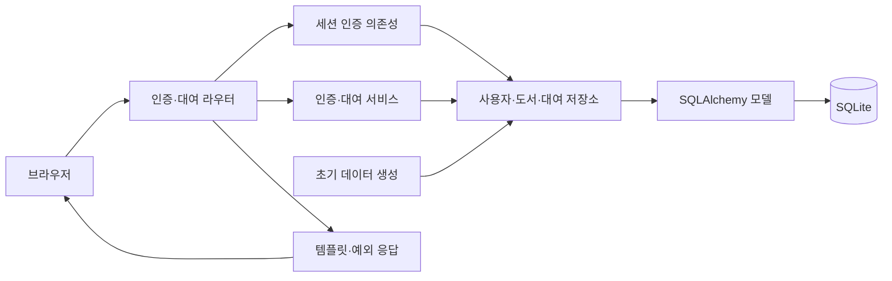

# 도서 대여 관리 서비스

## 프로젝트 소개

FastAPI, SQLAlchemy, Jinja2로 만든 세션 기반 도서 대여 웹 서비스입니다. 회원가입·로그인 후 도서를 등록하고 대여·반납하며 관계형 기록을 조회합니다.

## 핵심 특징

- 회원가입과 bcrypt 비밀번호 해시 검증 (기존 PBKDF2 계정 호환)
- GitHub OAuth2 Authorization Code + PKCE 소셜 로그인
- 로그인 사용자만 접근하는 대여 관리 화면
- 사용자·도서·대여 기록의 ORM 연관관계
- 도서 검색, 대여 상태 필터, 대여·반납 상태 전환
- 전역 예외 처리와 pytest의 인증·대여·반납 흐름 검증

## 아키텍처

`라우터 → 인증 의존성·서비스 → 저장소 → ORM → SQLite` 흐름입니다. `Loan`이 사용자와 도서를 연결하고 대여 상태·시각을 보관합니다.

| 경로 | 역할 |
| --- | --- |
| `src/library_service/main.py` | 앱 생성과 라우터·예외 처리 등록 |
| `src/library_service/bootstrap.py`, `src/library_service/core/` | 초기 데이터 생성·DB 연결·파일 경로 |
| `src/library_service/auth/` | 세션 사용자 조회와 보호 경로 의존성 |
| `src/library_service/routers/` | 인증 폼과 대여 화면 요청 |
| `src/library_service/services/` | 인증·대여 검증과 상태 변경 |
| `src/library_service/repositories/`, `src/library_service/models/` | DB 접근과 관계 매핑 |
| `src/library_service/ui/templates/`, `src/library_service/ui/static/` | 서버 렌더링 화면과 CSS |
| `tests/test_http.py`, `tests/conftest.py` | pytest HTTP 흐름·임시 DB fixture |



소스는 `src/library_service/`, 회귀 테스트는 `tests/`, 개발 보조 도구는 `scripts/`에 둡니다. `pyproject.toml`이 패키지·명령·개발 도구를 선언하고 `uv.lock`이 설치 버전을 고정합니다. `uv sync --frozen`은 소스를 개발 모드로 설치하므로 앱 실행과 테스트에 별도 `PYTHONPATH` 설정이 필요하지 않습니다.

## 실행 환경과 시작하기

Python 3.10 이상과 uv가 필요합니다. 저장소 루트에서 실행합니다.

```bash
uv sync --frozen
cp .env.example .env
# .env의 SESSION_SECRET_KEY를 자신만의 값으로 변경합니다.
set -a
. ./.env
set +a
uv run --frozen uvicorn library_service.main:app --host 127.0.0.1 --port 8000
```

기본 접속 주소는 `http://127.0.0.1:8000`입니다. 앱은 `.env`를 자동 로드하지 않으므로 위와 같이 셸에 설정합니다.

| 환경 변수 | 기본 동작 |
| --- | --- |
| `LIBRARY_DATABASE_URL` | 미설정 시 레포의 `library.db` 사용 |
| `SESSION_SECRET_KEY` | 세션 서명 키; 개발용 기본값 대신 직접 지정 |
| `LIBRARY_ENV` | 기본은 개발 도구 비활성화; `development`일 때만 디버그 버튼과 자산 경로 제공 |

개발 중에는 `make dev`로 실행하면 자동 재시작과 왼쪽 아래 `D` 디버그 버튼이 켜집니다. 버튼을 열면 가려진 현재 경로와 브라우저 오류의 시각·종류·안전한 요약을 확인하고 기록을 지울 수 있습니다. Enter/Space로 열고 Escape로 닫습니다. 오류 원문과 스택, 검색어와 URL query/hash는 수집하지 않습니다. 최근 50개 기록만 현재 문서 메모리에 유지하며 페이지 이동·새로고침 시 초기화합니다. 서버 오류 로그는 터미널에서 확인합니다. 배포 실행에서는 `LIBRARY_ENV`를 설정하지 않거나 `production`으로 두면 UI와 수집기를 로드하지 않고 개발 자산 경로도 제공하지 않습니다.

개발 환경의 최초 DB 초기화에서 샘플 도서와 데모 계정 `demo` / `demo1234`를 만듭니다. 운영 환경에서는 데모 계정을 생성하지 않으며, HTTPS 전용 쿠키와 32자 이상의 세션 키를 요구합니다. 개발 DB를 운영에 복사하지 마세요.

## 화면과 데이터 흐름

`/`, `/signup`, `/login`은 공개 화면이며 `/app`과 하위 경로는 로그인이 필요합니다. 비로그인 접근은 로그인 화면으로 이동합니다.

| 요청 | 기능 |
| --- | --- |
| `POST /signup`, `POST /login`, `POST /logout` | 인증과 세션 관리 |
| `GET /app?q=검색어&status=borrowed` | 검색과 대여 상태 필터 |
| `POST /app/books` | 도서 등록 |
| `POST /app/books/{book_id}/borrow` | 대여 기록 생성 |
| `POST /app/loans/{loan_id}/return` | 본인 대여 기록을 반납 상태로 변경 |

반납 시 기록 존재 여부, 소유권, `borrowed` 상태를 확인한 뒤 `returned` 상태와 반납 시각을 저장합니다. 상세 설명은 [서비스 설계](docs/service-design.md)에 있습니다.

## 검증

```bash
make check
make test
make smoke
make build
```

pytest fixture가 매 테스트마다 임시 SQLite DB와 FastAPI `TestClient`를 제공합니다. 인증·보호 경로·비밀번호 해시·등록·대여·반납·검색·실패 응답을 확인하며 실제 `library.db`는 사용하지 않습니다. 비로그인 변경 요청 거부, 잘못된 입력의 저장 방지, 중복 대여·타인 반납·반복 반납 실패와 관계 삭제 시 대여 기록 정리도 검사합니다.

`make check`는 정적 분석·포맷·문서 검사를, `make test`는 `uv run --frozen pytest -q`로 저장소의 전체 pytest suite를 실행합니다. `make smoke`는 같은 테스트 중 `smoke` 마커가 붙은 HTTP 확인을 선택합니다(`uv run --frozen pytest -q -m smoke`). 테스트는 임시 DB와 모의 HTTP 요청을 사용합니다. 실제 GitHub 계정 인증과 Railway 운영 환경은 별도 설정 후 검증해야 합니다.


## Railway 배포

루트 `Dockerfile`과 `railway.json`을 사용합니다. 잠금 파일로 운영 의존성을 설치하고,
Railway의 `PORT`로 실행하며 `/healthz`를 상태 확인 경로로 제공합니다.

1. Railway에서 이 GitHub 저장소를 연결한 서비스를 만듭니다.
2. 해당 서비스에 **Volume**을 연결하고 Mount Path를 `/data`로 설정합니다.
3. Variables에 다음 값을 설정합니다.

| 변수 | 운영 설정 |
| --- | --- |
| `LIBRARY_ENV` | `production` |
| `LIBRARY_DATABASE_URL` | `sqlite:////data/library.db` |
| `SESSION_SECRET_KEY` | `python -c "import secrets; print(secrets.token_urlsafe(48))"`로 생성한 값 |
| `GITHUB_CLIENT_ID` | GitHub OAuth App Client ID |
| `GITHUB_CLIENT_SECRET` | GitHub OAuth App Client Secret |
| `GITHUB_REDIRECT_URI` | 발급된 HTTPS 도메인 뒤에 `/auth/github/callback`을 붙인 주소 |

4. Deploy 후 Networking → Generate Domain으로 공개 도메인을 발급합니다.
5. GitHub OAuth App의 Authorization callback URL을 `GITHUB_REDIRECT_URI`와 정확히 일치시킵니다.
6. 새 도메인에서 회원가입 → 도서 등록 → 검색 → 대여 → 반납을 확인하고,
   로그아웃 후 GitHub 로그인 및 재로그인을 확인합니다.
7. 재배포 후에도 계정·도서·대여 기록이 유지되는지 확인하고 실제 공개 URL을 제출합니다.

GitHub 변수가 없으면 일반 회원가입·로그인은 동작하며 소셜 로그인 시 설정 안내가 표시됩니다.
OAuth 토큰은 DB·브라우저 세션에 저장하지 않습니다. callback 코드가 액세스 로그에 남지 않도록
컨테이너의 Uvicorn 액세스 로그는 비활성화합니다. 서버 오류 로그는 유지합니다.

SQLite 구성은 단일 서비스 인스턴스용입니다. Volume 없는 배포는 재배포 때 데이터가 사라질 수 있습니다.
배포 전 Volume 백업을 만들고, 문제 발생 시 이전 Railway Deployment로 되돌리세요.
새 `oauth_identities` 테이블은 기존 사용자 테이블을 변경하지 않고 생성합니다.
현재 소스 설정만으로 공개 URL이 발급되지는 않으며, Railway 계정에서 위 배포를 완료해야 합니다.

## 추가 기능과 오류 계약

- `/app?q=검색어&availability=available&status=borrowed`: 제목·저자·설명 검색,
  도서 대여 가능 여부와 내 대여 상태를 조합합니다. 검색의 `%`, `_`는 와일드카드가 아닌 문자로 처리합니다.
- 회원가입: 아이디 영문·숫자·밑줄·하이픈 3~50자, 표시 이름 1~80자,
  비밀번호 8자 이상·UTF-8 72바이트 이하. bcrypt 솔트가 계정별로 생성됩니다.
- `/auth/github` → GitHub → `/auth/github/callback`: state·10분 만료·PKCE를 검증합니다.
  기존 계정을 이메일이나 사용자 이름으로 자동 연결하지 않고, GitHub 고유 ID로 식별합니다.
- 커스텀 도메인 예외, 404/405, 입력 검증 422, 서버 오류 500에 공통 오류 화면을 제공합니다.
  `Accept: application/json` 요청에는 `{"error": {"status": 404, "message": "..."}}` 형태를 반환합니다.
  내부 예외 내용이나 비밀번호는 응답에 포함하지 않습니다.
