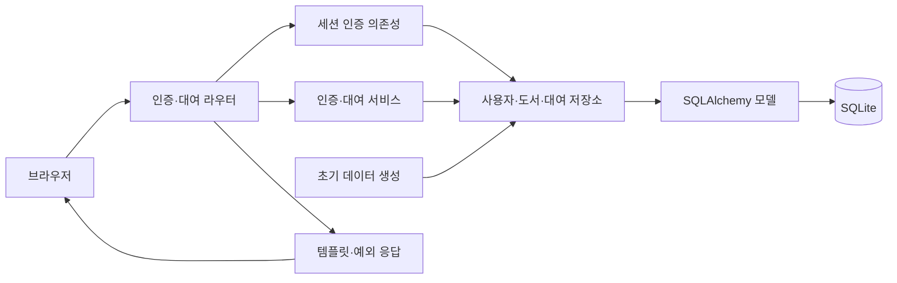
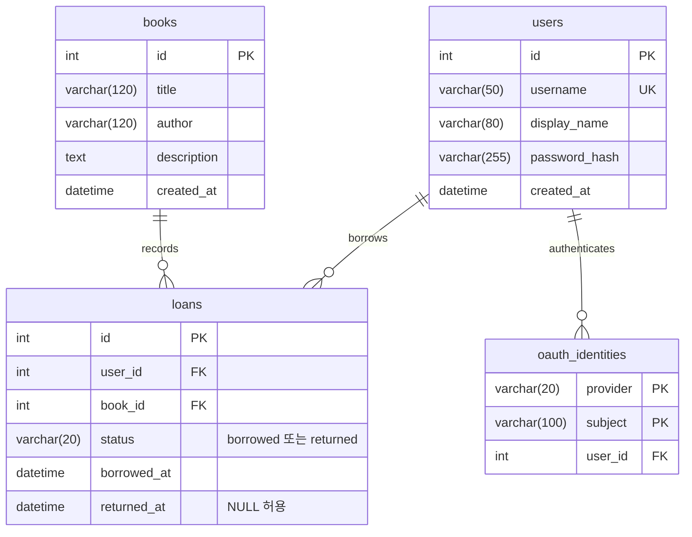

# 도서 대여 관리 서비스

## 프로젝트 소개

FastAPI, SQLAlchemy, Jinja2로 만든 세션 기반 도서 대여 웹 서비스입니다. 회원가입·로그인 후 도서를 등록하고 대여·반납하며 관계형 기록을 조회합니다.

공개 서비스: [코드 도서관](https://library-loan-management-service.onrender.com) — 2026-10-22 Render Free Web Service 첫 배포 완료(`Deploy succeeded | Live`).

## 핵심 특징

- 회원가입과 bcrypt 비밀번호 해시 검증 (기존 PBKDF2 계정 호환)
- GitHub OAuth2 Authorization Code + PKCE 소셜 로그인
- 로그인 사용자만 접근하는 대여 관리 화면
- 사용자·도서·대여 기록의 ORM 연관관계
- 도서 검색, 대여 상태 필터, 대여·반납 상태 전환
- 전역 예외 처리와 pytest의 인증·대여·반납 흐름 검증

## 아키텍처

`라우터 → 인증 의존성·서비스 → 저장소 → ORM → SQLite` 흐름입니다. `Loan`이 사용자와 도서를 연결하고 대여 상태·시각을 보관합니다.

| 경로 | 역할 |
| --- | --- |
| `src/library_service/main.py` | 앱 생성과 라우터·예외 처리 등록 |
| `src/library_service/bootstrap.py`, `src/library_service/core/` | 초기 데이터 생성·DB 연결·파일 경로 |
| `src/library_service/auth/` | 세션 사용자 조회와 보호 경로 의존성 |
| `src/library_service/routers/` | 인증 폼과 대여 화면 요청 |
| `src/library_service/services/` | 인증·대여 검증과 상태 변경 |
| `src/library_service/repositories/`, `src/library_service/models/` | DB 접근과 관계 매핑 |
| `src/library_service/ui/templates/`, `src/library_service/ui/static/` | 서버 렌더링 화면과 CSS |
| `tests/test_http.py`, `tests/conftest.py` | pytest HTTP 흐름·임시 DB fixture |



소스는 `src/library_service/`, 회귀 테스트는 `tests/`, 개발 보조 도구는 `scripts/`에 둡니다. `pyproject.toml`이 패키지·명령·개발 도구를 선언하고 `uv.lock`이 설치 버전을 고정합니다. `uv sync --frozen`은 소스를 개발 모드로 설치하므로 앱 실행과 테스트에 별도 `PYTHONPATH` 설정이 필요하지 않습니다.

## 실행 환경과 시작하기

Python 3.10 이상과 uv가 필요합니다. 저장소 루트에서 실행합니다.

```bash
uv sync --frozen
cp .env.example .env
# .env의 SESSION_SECRET_KEY를 자신만의 값으로 변경합니다.
set -a
. ./.env
set +a
uv run --frozen uvicorn library_service.main:app --host 127.0.0.1 --port 8000
```

기본 접속 주소는 `http://127.0.0.1:8000`입니다. 앱은 `.env`를 자동 로드하지 않으므로 위와 같이 셸에 설정합니다.

| 환경 변수 | 기본 동작 |
| --- | --- |
| `LIBRARY_DATABASE_URL` | 미설정 시 레포의 `library.db` 사용 |
| `SESSION_SECRET_KEY` | 세션 서명 키; 개발용 기본값 대신 직접 지정 |
| `LIBRARY_ENV` | 기본은 개발 도구 비활성화; `development`일 때만 디버그 버튼과 자산 경로 제공 |

개발 중에는 `make dev`로 실행하면 자동 재시작과 왼쪽 아래 `D` 디버그 버튼이 켜집니다. 버튼을 열면 가려진 현재 경로와 브라우저 오류의 시각·종류·안전한 요약을 확인하고 기록을 지울 수 있습니다. Enter/Space로 열고 Escape로 닫습니다. 오류 원문과 스택, 검색어와 URL query/hash는 수집하지 않습니다. 최근 50개 기록만 현재 문서 메모리에 유지하며 페이지 이동·새로고침 시 초기화합니다. 서버 오류 로그는 터미널에서 확인합니다. 배포 실행에서는 `LIBRARY_ENV`를 설정하지 않거나 `production`으로 두면 UI와 수집기를 로드하지 않고 개발 자산 경로도 제공하지 않습니다.

개발 환경의 최초 DB 초기화에서 샘플 도서와 데모 계정 `demo` / `demo1234`를 만듭니다. 운영 환경에서는 데모 계정을 생성하지 않으며, HTTPS 전용 쿠키와 32자 이상의 세션 키를 요구합니다. 개발 DB를 운영에 복사하지 마세요.

## 화면과 데이터 흐름

`/`, `/signup`, `/login`은 공개 화면이며 `/app`과 하위 경로는 로그인이 필요합니다. 비로그인 접근은 로그인 화면으로 이동합니다.

| 요청 | 기능 |
| --- | --- |
| `POST /signup`, `POST /login`, `POST /logout` | 인증과 세션 관리 |
| `GET /app?q=검색어&status=borrowed` | 검색과 대여 상태 필터 |
| `POST /app/books` | 도서 등록 |
| `POST /app/books/{book_id}/borrow` | 대여 기록 생성 |
| `POST /app/loans/{loan_id}/return` | 본인 대여 기록을 반납 상태로 변경 |

반납 시 기록 존재 여부, 소유권, `borrowed` 상태를 확인한 뒤 `returned` 상태와 반납 시각을 저장합니다. 상세 설명은 [서비스 설계](docs/service-design.md)에 있습니다.

## ERD

`src/library_service/models/entities.py`의 SQLAlchemy 모델을 기준으로 작성했습니다.



사용자와 도서는 각각 대여 기록을 0개 이상 가질 수 있고, 각 대여 기록은 사용자 1명과 도서 1권에 연결됩니다. `returned_at`을 제외한 모든 컬럼은 NULL을 허용하지 않습니다.

`oauth_identities`는 GitHub 등 외부 인증 정보를 사용자에 연결하며, `provider`와 `subject`를 복합 기본 키로 사용합니다.

## 검증

```bash
make check
make test
make smoke
make build
```

pytest fixture가 매 테스트마다 임시 SQLite DB와 FastAPI `TestClient`를 제공합니다. 인증·보호 경로·비밀번호 해시·등록·대여·반납·검색·실패 응답을 확인하며 실제 `library.db`는 사용하지 않습니다. 비로그인 변경 요청 거부, 잘못된 입력의 저장 방지, 중복 대여·타인 반납·반복 반납 실패와 관계 삭제 시 대여 기록 정리도 검사합니다.

`make check`는 정적 분석·포맷·문서 검사를, `make test`는 `uv run --frozen pytest -q`로 저장소의 전체 pytest suite를 실행합니다. `make smoke`는 같은 테스트 중 `smoke` 마커가 붙은 HTTP 확인을 선택합니다(`uv run --frozen pytest -q -m smoke`). 테스트는 임시 DB와 모의 HTTP 요청을 사용합니다. Render 첫 배포 성공은 대시보드에서 확인했으며, 공개 서비스의 회원가입·대여·반납 흐름과 실제 GitHub 계정 인증은 별도로 검증합니다.


## Render 배포

2026-10-22 Render 대시보드에서 첫 배포의 `Deploy succeeded | Live` 상태를 확인했습니다.
배포 소스는 `main` 브랜치의 커밋 `7ab9080`입니다. 해당 커밋 제목에 Railway가 포함되어 있지만,
실제 배포 플랫폼은 Render입니다. 저장소의 `railway.json`은 Railway용 설정이며 Render에서는 사용하지 않습니다.

| 항목 | 현재 설정 |
| --- | --- |
| 공개 URL | <https://library-loan-management-service.onrender.com> |
| 서비스 유형 | Free Web Service |
| Language | Docker |
| Dockerfile Path | `./Dockerfile` |
| Root Directory / Docker Command | 비워 둠; 루트 디렉터리와 Dockerfile의 기본 실행 명령 사용 |
| Health Check Path | `/healthz` |
| DB | SQLite, `/app/library.db` (영구 디스크 없음) |

루트 `Dockerfile`이 잠금 파일로 운영 의존성을 설치하고, Render의 `PORT`로 Uvicorn을 실행합니다.
`/healthz`는 서버 상태 확인 경로이며 정상 응답은 `{"status":"ok"}`입니다.
[상태 확인 주소](https://library-loan-management-service.onrender.com/healthz)에서 응답을 확인할 수 있습니다.

### 배포 재현

1. Render에서 **New → Web Service**를 누르고 GitHub 저장소를 연결합니다.
2. 배포할 브랜치를 선택하고 **Language: Docker**, **Compute: Free**로 설정합니다.
3. **Environment Variables**에 다음 세 값을 입력합니다.

| Key | Value |
| --- | --- |
| `LIBRARY_ENV` | `production` |
| `LIBRARY_DATABASE_URL` | `sqlite:////app/library.db` |
| `SESSION_SECRET_KEY` | 32자 이상의 무작위 비밀키 |

세션 비밀키는 다음 명령으로 생성합니다. 실제 비밀키는 Render 환경 변수에만 저장하고 문서나 저장소에 넣지 않습니다.

```bash
python3 -c "import secrets; print(secrets.token_urlsafe(48))"
```

4. **Advanced → Health Check Path**에 `/healthz`를 입력합니다.
5. **Deploy web service**를 누르고 `Live` 상태와 공개 URL을 확인합니다.

### 무료 배포의 데이터 보관 범위

현재 배포는 실습·시연용입니다. Free 서비스는 15분간 요청이 없으면 절전 상태로 들어가며,
다음 접속 때 다시 켜지는 데 약 1분이 걸릴 수 있습니다.
**재배포·재시작·절전 시 SQLite 파일이 삭제되어 회원·도서·대여 기록이 초기화됩니다.**
Free 서비스에는 영구 디스크를 연결할 수 없습니다. 자세한 제한은 [Render 공식 문서](https://render.com/docs/free)를 참고하세요.

데이터를 계속 보관하려면 유료 Web Service에 영구 디스크를 `/data`로 연결하고
`LIBRARY_DATABASE_URL=sqlite:////data/library.db`로 변경해야 합니다.
이 변경만으로 기존 `/app/library.db` 데이터가 자동 이전되지는 않습니다.
SQLite 구성은 단일 서비스 인스턴스용입니다.

### 공개 서비스 확인과 GitHub 로그인

배포 성공과 사용자 기능 검증은 구분합니다. 공개 주소에서 회원가입 → 로그인 → 도서 등록 → 검색 → 대여 → 반납 → 로그아웃을 확인합니다.
운영 모드에서는 데모 계정을 만들지 않으므로 직접 회원가입합니다.

GitHub 로그인을 사용하려면 아래 변수를 추가하고 실제 계정으로 로그인·재로그인을 확인합니다.

| 변수 | 설정 |
| --- | --- |
| `GITHUB_CLIENT_ID` | GitHub OAuth App Client ID |
| `GITHUB_CLIENT_SECRET` | GitHub OAuth App Client Secret |
| `GITHUB_REDIRECT_URI` | `https://library-loan-management-service.onrender.com/auth/github/callback` |

GitHub OAuth App의 Authorization callback URL은 `GITHUB_REDIRECT_URI`와 정확히 일치시킵니다.
별도 도메인으로 배포할 때는 두 주소를 함께 변경합니다.
GitHub 변수가 없으면 일반 회원가입·로그인은 동작하며 소셜 로그인 시 설정 안내가 표시됩니다.
OAuth 토큰은 DB·브라우저 세션에 저장하지 않습니다. callback 코드가 액세스 로그에 남지 않도록
컨테이너의 Uvicorn 액세스 로그는 비활성화합니다. 서버 오류 로그는 유지합니다.
새 `oauth_identities` 테이블은 기존 사용자 테이블을 변경하지 않고 생성합니다.

## 추가 기능과 오류 계약

- `/app?q=검색어&availability=available&status=borrowed`: 제목·저자·설명 검색,
  도서 대여 가능 여부와 내 대여 상태를 조합합니다. 검색의 `%`, `_`는 와일드카드가 아닌 문자로 처리합니다.
- 회원가입: 아이디 영문·숫자·밑줄·하이픈 3~50자, 표시 이름 1~80자,
  비밀번호 8자 이상·UTF-8 72바이트 이하. bcrypt 솔트가 계정별로 생성됩니다.
- `/auth/github` → GitHub → `/auth/github/callback`: state·10분 만료·PKCE를 검증합니다.
  기존 계정을 이메일이나 사용자 이름으로 자동 연결하지 않고, GitHub 고유 ID로 식별합니다.
- 커스텀 도메인 예외, 404/405, 입력 검증 422, 서버 오류 500에 공통 오류 화면을 제공합니다.
  `Accept: application/json` 요청에는 `{"error": {"status": 404, "message": "..."}}` 형태를 반환합니다.
  내부 예외 내용이나 비밀번호는 응답에 포함하지 않습니다.
